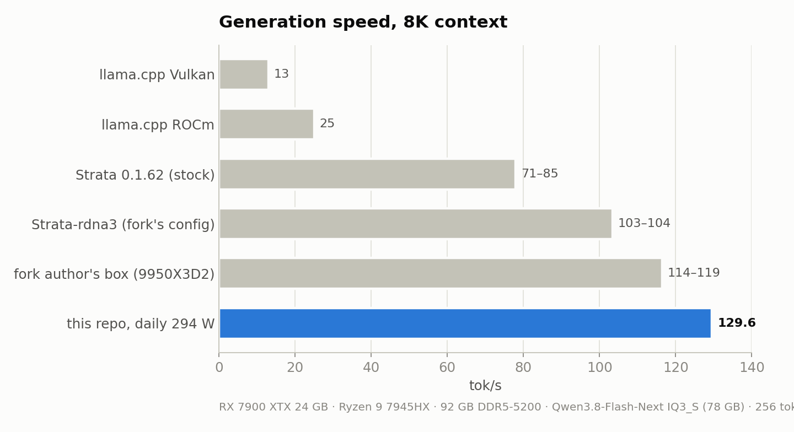
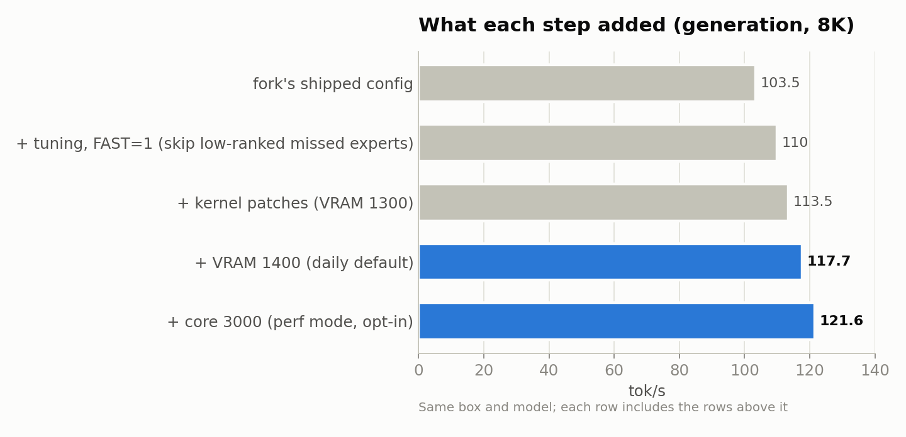
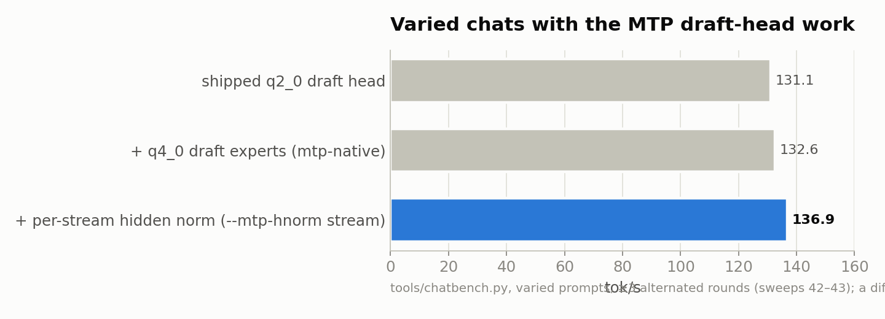
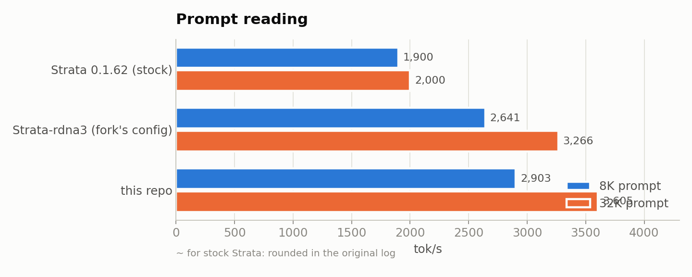
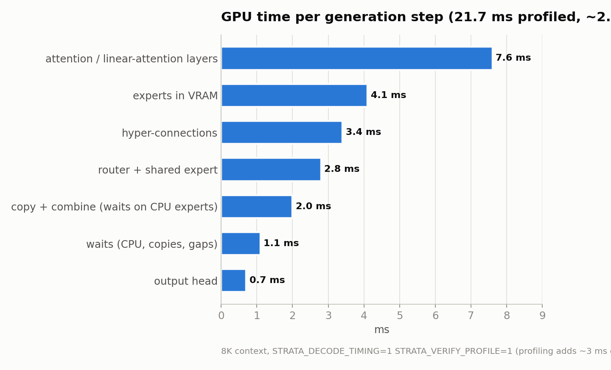

# rdna3-moe-tuning

Run **Qwen3.8-Flash-Next (IQ3_S, 82 GB MoE)** on a **single RX 7900 XTX (24 GB)** at **~130 tok/s**,
within a 294 W power cap. One script installs, tunes, serves and benchmarks
[Strata-rdna3](https://github.com/nicejunjie/Strata-rdna3), a gfx1100-tuned fork of the Strata engine.

The model is 3–4× larger than VRAM. The engine keeps the most-used experts in VRAM (~90% hit rate), computes
the rest on the CPU in parallel, and drafts 4 tokens ahead with an MTP head.

## Summary

| | daily (`serve`) | perf mode (`perf`, opt-in) |
|---|---:|---:|
| generation, 8K / 32K context | 129.6 / 122.7 tok/s | 121.6 / 122.5 tok/s (measured before the MTP work; not re-run) |
| clocks | core 2300, VRAM 1400 | core 3000, VRAM 1400 |
| power | 294 W cap, ~230 W used | 294 W cap, ~287 W used (coil whine) |

```bash
./strata-rdna3.sh install   # once: deps, engine + kernel patches, model, expert pack
./strata-rdna3.sh serve     # daily clocks, server on 127.0.0.1:8080 (HOST=0.0.0.0 for the LAN)
./strata-rdna3.sh perf      # same server, perf clocks; run `serve` again to go back
./strata-rdna3.sh status    # is it up, GPU power and VRAM
./strata-rdna3.sh monitor   # live view (q leaves it running)
./strata-rdna3.sh stop      # stop it (always stop before bench / quality)
./strata-rdna3.sh bench     # 8K + 32K benchmark
./strata-rdna3.sh build     # rebuild the engine with patches/ after changing them
```

Clock changes need root: install the passwordless helper once (`tools/strata-oc`, steps in its header).
After a reboot the card sleeps until `serve` or `perf` wakes it. Running two benchmark or quality jobs
at once has crashed the box, and VRAM 1500 MHz crashes it too.

Everything below is detail: hardware, measurements, every setting and everything tried.

## The box

| part | what |
|---|---|
| GPU | AMD Radeon RX 7900 XTX 24 GB (gfx1100), 294 W cap, core ≤2300 MHz, VRAM 1400 MHz, −50 mV |
| CPU | AMD Ryzen 9 7945HX (16 Zen 4 cores, 2 CCDs, AVX-512) |
| RAM | 92 GB DDR5-5200, dual channel |
| OS / stack | Ubuntu 24.04, ROCm 7.2.4 |
| model | Qwen3.8-Flash-Next GSQ-RCO IQ3_S (78 GB on disk), 128K context, int8 KV |

## Results

Single user, distinct prompts, 256 generated tokens, median of 5 runs, greedy.









| | prompt 8K | prompt 32K | generation 8K / 32K |
|---|---:|---:|---:|
| **this repo, + MTP draft-head work (q4_0, per-stream norm, retrained; default)** | **2,870** | **3,593** | **129.6 / 122.7** |
| this repo, `FAST=1` + kernel patches, VRAM 1400 | 2,903 | 3,605 | 117.7 / 117.4 |
| this repo, `FAST=1` + kernel patches, VRAM 1300 | 2,860 | 3,556 | 113–114 / 114 |
| this repo, `FAST=1`, before the kernel patches | 2,860 | 3,555 | 109–111 / 109 |
| this repo, `FAST=0` (exact answers) | 2,840 | 3,553 | 101 / 103 |
| fork's shipped config | 2,641 | 3,266 | 103–104 |
| fork author (9950X3D2, DDR5-6000) | 2,436 | 3,541 | 114–119 |
| stock Strata 0.1.62 | ~1,900 | ~2,000 | 71–85 |
| llama.cpp ROCm `-ncmoe 32 -ub 2048 -fa 1` | 1,112 (2K) | — | 25 |
| llama.cpp Vulkan `-ncmoe 22` | 103 (512) | — | 13 |

Real chats are faster than the benchmark because a conversation's earlier prompt is reused: coding-tool sessions
on this box log 122–137 tok/s generation (`./strata-rdna3.sh speed`).

### Where a generation step's time goes

One step verifies the MTP drafts and keeps ~2.1 tokens in ~20 ms. The GPU is the limit. Most of "copy + combine"
is the GPU waiting on the ~2 experts a layer that miss VRAM; the CPU pool already runs them near this box's RAM
bandwidth ceiling (~50 GB/s), so faster CPU code would barely help. GPU time per step
(8K context, `STRATA_DECODE_TIMING=1 STRATA_VERIFY_PROFILE=1`):



Charts: `python3 tools/plots.py` (numbers in the script). Raw numbers: [`snapshot/2026-11-21/`](snapshot/2026-11-21/) (stock Strata, llama.cpp, first fork sweeps),
[`snapshot/2026-11-22/`](snapshot/2026-11-22/) (CPU kernel / routing sweep with quality check, engine-switch
sweep, profile, kernel benches and sweeps 7–11, `bench-final.log`).

## Install

Needs Ubuntu 24.04 (or similar), ROCm 7.x in `/opt/rocm`, your user in the `render` and `video` groups,
~140 GB of free disk, and 64 GB+ RAM.

```bash
git clone https://github.com/toreanjoel/rdna3-moe-tuning && cd rdna3-moe-tuning
./strata-rdna3.sh install    # deps (sudo), engine build for gfx1100, model download if missing, expert pack, q4_0 MTP head
./strata-rdna3.sh serve      # tune the card, start the server in the background
```

The server speaks OpenAI (`/v1/chat/completions`, `/v1/responses`) and Anthropic (`/v1/messages`) on `127.0.0.1:8080`:

```bash
curl -s localhost:8080/v1/chat/completions -H 'Content-Type: application/json' \
  -d '{"messages":[{"role":"user","content":"hi"}],"max_tokens":512}'
```

Coding tools work against it with tool calls and streaming: OpenAI chat (Cursor, Continue, Cline, Roo, Aider),
Anthropic messages (Claude Code: `ANTHROPIC_BASE_URL=http://127.0.0.1:8080`) and OpenAI Responses (Codex).
`python3 tools/api_smoke.py [url]` checks all three (9/9 pass, 5 runs in a row). The model thinks before it
answers: give tools a max-tokens of 512 or more. [`examples/shop-cart`](examples/shop-cart) is a small coding
task to try a tool against it.

## Commands

| command | does |
|---|---|
| `install` | one-time setup (idempotent) |
| `mtp4` | build the q4_0 MTP draft head (part of `install`; for older installs). `serve` uses it when present; `MTP=2` = the shipped q2_0 head |
| `serve` | apply tuning, (re)start the server; survives logout |
| `perf` | `serve` with perf clocks (core 3000, VRAM 1400), opt-in; [perf mode](#perf-mode-not-default) |
| `stop` / `status` | stop it / port, process, GPU power and VRAM |
| `monitor` | attach a live view (speed, requests, GPU); `q` detaches, server keeps running |
| `speed` | follow each request's prompt and generation tok/s from the log |
| `quality` | ~1 h: FAST vs exact on this box: next-token agreement, KL, perplexity, HumanEval pass@1 |
| `bench [lengths]` | the fork's benchmark (default `8192,32768`; `BENCH_TEMP=0.6` for sampled answers) |
| `tune` | apply clocks and power only |
| `uninstall` | remove everything the script created |

Everything lives under one folder (`R=`, default `~/work/rdna3`): `engine/`, `data/` (model, expert pack,
MTP head), `logs/`, `bench/`.

## Settings

Defaults are the measured best within the card's limits. Override any of them per run, for example
`FAST=0 ./strata-rdna3.sh serve`.

| variable | default | notes |
|---|---|---|
| `FAST` | 1 | skip low-ranked missed experts: +7–10% generation, answers change slightly ([below](#what-was-tried)); `0` = exact |
| `CTX` | 131072 | max context; the fork ships 262144 (128K frees ~1% more expert slots) |
| `WATTS` | 294 | power cap; the ceiling for this card |
| `SCLK` | 2300 | core clock max (MHz); kept low for coil whine, see [perf mode](#perf-mode-not-default) |
| `MCLK` | 1400 | VRAM clock (MHz); +2.5% over 1300 and stable, 1500 crashes the box |
| `MTP` | ft | draft head: ft = retrained on this model (`data/mtp/rt-ft`, falls back to q4_0 if not built), 4 = q4_0 experts (built by `mtp4`), 2 = the shipped q2_0 |
| `HNORM` | 1 | draft layer normalizes each hyper-connection stream on its own (`--mtp-hnorm stream`, +4.3%); 0 = the fork's pooled norm |
| `DVOCAB` | 1 | draft vocabulary = the fork's zh60k subset + 5,725 tokens this model writes that the subset lacks (`tools/draft_vocab_plus.bin`, +3.0%); 0 = zh60k |
| `CUMX` | 1 | draft window by cumulative draft probability against the measured cost of each extra row (`patches/spec-cumx.patch`, +1.1%); 0 = `--spec-min-p 0.5` per draft |
| `VO` | -50 | core voltage offset (mV) |
| `EPP` / `BOOST` | performance / 1 | the CPU computes the experts not cached in VRAM |
| `TABLE` | hipBLASLt `100202` | matches ROCm 7.2.x: prompts +8% |
| `HOST` / `PORT` | 127.0.0.1 / 8080 | `HOST=0.0.0.0` for the LAN |
| `XENV` / `XARGS` | — | extra engine env / flags, e.g. `XARGS="--spec 3"` |
| `NAME` / `REPEATS` | default / 3 | bench run name and repeats |

### Perf mode (not default)

How far the card goes with the clocks uncapped, still at the 294 W cap and -50 mV. It runs at the
power limit with coil whine, so it stays opt-in:
`./strata-rdna3.sh perf` (same as `SCLK=3000 MCLK=1400 ./strata-rdna3.sh serve`). A plain `./strata-rdna3.sh serve` goes back to daily clocks.
Clock changes need root; `tools/strata-oc` is a passwordless helper (install steps in its header).
The table below is sweep19 (2026-11-22, before the latest kernel patches); with them, daily 2300 / 1400 benches 117.7 / 117.4 (2026-11-23).

| SCLK / MCLK | 8K tok/s | 32K tok/s | busy clock / power / hotspot |
|---|---|---|---|
| 2300 / 1300 (old daily) | 111.0 | 109.6 | 2244 MHz, 230 W, 62 °C |
| 2300 / 1400 (daily) | 113.7 | 112.7 | 2247 MHz, 244 W, 67 °C |
| 2300 / 1450 | 112.9 | 111.6 | 2238 MHz, 248 W, 56 °C |
| 2300 / 1500 | — | — | box hard-crashed on apply |
| 2700 / 1400 | 118.7 | 119.9 | 2441 MHz, 284 W, 66 °C |
| **3000 / 1400** | **121.6** | **122.5** | 2505 MHz, 287 W, 70 °C |

At 3000 the card hits the 294 W cap and holds ~2500 MHz, so higher SCLK settings add little; more speed
would need more power. Raw output: [`snapshot/2026-11-22/sweep19.txt`](snapshot/2026-11-22/sweep19.txt) (`tools/sweep19.sh`, REPEATS 3).

## What was tried

| change | effect | kept |
|---|---|---|
| hipBLASLt table matching ROCm 7.2.x | prompts +7.5% (8K), +8.8% (32K) | yes |
| `--adapt-swaps 48` / `64` | within noise | no |
| `STRATA_AUX_CPUS=auto` | none | no |
| `--pool-workers 14` | none | no |
| `--pcie-frac 0.15` | generation −5% | no |
| `--spec-min-p 0.3`, `--lookup-chain 3` | within noise | no |
| `STRATA_MTP_DRAFT_ALL`, `MTP_QFUSE/MULTICOPY/GR_R8` | within noise | no |
| `STRATA_MEGAKERNEL=1` | within noise | no |
| `STRATA_IQ_PREFETCH` 1024 / 4096, `STRATA_CPU_YMM=1` (CPU expert kernels) | within noise | no |
| `STRATA_ROUTE_TAIL_SKIP=7` (`FAST=1`, default) | generation 101→111 (8K), 103→109 (32K); top-1 agreement 92.6%, KL 0.050, reference perplexity 4.064→4.041 | yes |
| `--max-context 131072` | 9,328→9,444 experts in VRAM | yes |
| `STRATA_ROUTE_TAIL_SKIP=8` | 109 / 106; KL 0.047 | no (7 is faster, same cost) |
| `STRATA_ROUTE_RESIDENT=0.5` / `1.0`, `STRATA_ROUTE_PRIOR=0.5` | 105–110; KL 0.08–0.09, top-1 ~90% | no |
| `STRATA_ADAPT_LAG=2 ADAPT_NOWAIT=1 ADAPT_OVERLAP=0` | two A/B pairs: +3% at 8K, −1% at 32K | no (noise) |
| `STRATA_SPEC_COUPLED=1` (± `GUMBEL`), sampled at T=0.6 | 108/114 → 101–105 | no |
| gfx1151 decode set (`LANECELL`, `MMVF_ROWS`, `TSUM`, `LFUSE`, `GDN_SPLIT`, `PLE_BATCH`, `EXPERT_V2`) | −2–3% | no |
| `STRATA_GDN_SPLIT=1` alone (GDN step on 4 blocks a head + a norm kernel; 2026-11-23) | 114.4 → 112.9, same answers: more blocks don't speed the recurrence, the extra launch costs ~0.25 ms | no |
| `MMVF_ROWS` / `TSUM` / `ATTN_LANECELL` / `Q6_PACKED`, each alone (2026-11-23, `snapshot/2026-11-23/sweep34.txt`) | 114.3 → 113.2 / 114.3 / 114.2 / 115.1; Q6_PACKED's ms/window is unchanged and its answers differ (acceptance luck, not speed) | no |
| `STRATA_EXP_AUTO=2` (IQ3_XXS gate/up + SwiGLU + q8_1 in one launch; 2026-11-23) | 114.4 → 114.0, same answers: the launch saved is lost in the slower fused kernel | no |
| Tree drafting (also verify the MTP head's runner-up; measured with [`patches/mtp-top2.patch`](patches/mtp-top2.patch), 2026-11-23) | runner-up right on 33–41% of rejected drafts: ~+0.15 tokens a window (+7% at best) for up to 3 more verify rows | no |
| MTP head experts at q4_0 / q8_0 instead of the shipped q2_0 ([`patches/mtp-native.patch`](patches/mtp-native.patch), `./strata-rdna3.sh mtp4`; 2026-11-23) | varied chats 131.1 → 132.6 (q4_0) / 130.0 (q8_0); 2-prompt bench mixed (8K +4%, 32K −3% for q4_0, the text changes); q8 keeps +4–8% more tokens but costs ~960 expert-cache slots | **q4_0 yes** (`MTP=2` = shipped) |
| `--mtp-hnorm stream` (the draft layer's hidden-input RMS per hyper-connection stream, as llama.cpp's qwen4exp MTP graph, not one RMS over all four; 2026-11-23, `snapshot/2026-11-23/sweep42.txt`, `sweep43.txt`) | varied chats 131.2 → 136.9 (+4.3%, 4 rounds, 136.1–137.1 each) | **yes** (`HNORM=0` = pooled) |
| English-only draft vocabulary (`--mtp-draft-vocab data/draft_vocab_en.bin`) / the full vocabulary (`STRATA_MTP_FULL_HEAD=1`) | +2.6% alone, +0.2% on top of hnorm / −3.9% | no (non-English drafts would lose) / no |
| MTP draft layer retrained on this model's greedy answers (`tools/mtp_train.py`, 1,500 prompts, 2,000 steps; `logs/sweep44.txt`; 2026-11-23) | held-out draft top-1 75.5 → 81.9% (step 1); varied chats 136.3 → 137.2 (+0.7%, 136.1/136.7/136.2 vs 137.1/137.1/137.5) | **yes** (`MTP=ft`, default once built) |
| `--spec 5` / `--spec-min-p 0.4` with the retrained head (`logs/sweep45.txt`, `sweep46.txt`; 2026-11-23) | varied chats 136.8 → 137.3 / 136.8 (3 rounds); bench 8K 129.6 → 121.0, 32K 122.7 → 119.5 (2 rounds each) | no |
| Draft acceptance logged per position in the server (`STRATA_SPEC_TRACE`, [`patches/spec-cumx.patch`](patches/spec-cumx.patch), `tools/ab.sh TRACE=1`, `tools/spectrace.py`; `snapshot/2026-11-23/ab48a.txt`, `ab48b.txt`) | 2.63 tokens a round; rounds that keep no draft 25% (11% none offered, 14% offered and rejected); drafts hold 84 / 83 / 82% at positions 1–3; rows 2 / 3 / 4 of a window cost 1.1 / 2.0 / 2.9 ms | measurement |
| Draft window by a cumulative rule: row k stays while the product of the draft probabilities ≥ tokens-per-ms × the ms that row adds (`STRATA_SPEC_CUMX=1`; `snapshot/2026-11-23/ab48c.txt`) | varied chats 133.0 / 133.0 / 132.5 → 134.9 / 133.2 / 134.6 (+1.1%, 3 of 3 rounds); 2.63 → 2.82 tokens a round | **yes** (`CUMX=0` = min-p) |
| Wider draft vocabulary: zh60k cannot emit 5% of the tokens the model writes ("replication", "PostgreSQL"); + the 5,725 other tokens seen in its own answers and coding sessions (`tools/draft_vocab_plus.py`; `snapshot/2026-11-23/ab49.txt`) | varied chats 133.1 / 132.4 / 132.4 → 135.4 / 136.0 / 138.3 (+3.0%, 3 of 3); zh60k + every id below 100,000 (117k tokens): +1.1% | **yes** (`DVOCAB=0` = zh60k) |
| Train/serve check of the draft head on the rows the server drafts from (`tools/mtp_check.py`, `STRATA_MTP_DUMP_DEC`; `snapshot/2026-11-23/mtp-check-q4.txt`) | decode-path vs prompt-path rows: same accuracy; run-time Q4_0 quantization costs 0.6–1.4 points; on unseen prompts the retrained head scores what the shipped one does (77.3%): round 1 memorised its templated prompts | round 2: `tools/mtp_round2.sh` |
| `STRATA_HC_REQ8=1` | 114 / 107, prompts −5% | no |
| `STRATA_COPY_HIP_PRIO=1`, `--host-core sibling` | −3% / none | no |
| higher core clock (no SCLK cap) | ~+1 tok/s, coil whine | no |
| llama.cpp (Vulkan, ROCm) | 4–8× slower generation | no |
| `HIP_FORCE_DEV_KERNARG=1`, `DEBUG_CLR_GRAPH_PACKET_CAPTURE=0` | none | no |
| `STRATA_RDNA_PAIR=1` (shared expert's gate + up in one GEMV) | 108.8 → 109.4, same answers | yes |
| `STRATA_GR_TAIL=1` ([`patches/gr-tail.patch`](patches/gr-tail.patch): hyper-connection read's serial tail) | 0.3–2.3 µs less per read; with PAIR 108.8 → 109.9, same answers | yes |
| `STRATA_EXP_AUTO=1` ([`patches/exp-auto.patch`](patches/exp-auto.patch): IQ2_S gate/up fused, Q2_0 down in LDS) | 109.7 → 110.7, same answers | yes |
| `STRATA_LFUSE=1`; hc read with the up weights preloaded | none | no |
| Q2_0 expert down on EXPDEC's staged kernel, 2 rows a lane (in `exp-auto.patch`; `STRATA_EXP_AUTO=5` = the LDS kernel) | kernel −10–23%; 110.6 → 110.8, same answers | yes |
| IQ4_XS GEMV at 1–2 tokens unrolled 2 ([`patches/kq-unroll.patch`](patches/kq-unroll.patch); `STRATA_RDNA_KQ_UNR=0` = stock) | kernel 56 → 26 µs; 110.6 → 110.8 (8K), 111.0 → 111.35 (32K), same answers | yes |
| RDNA Q4_K GEMV from 3 tokens, 2 on 6144-wide rows (in `kq-unroll.patch`; `STRATA_RDNA_KQ_MIN=0` = stock) | kernel −15–25% on 2–3 token windows; 110.9 → 111.25 (8K), 111.5 → 112.0 (32K); not bitwise (float order), vs stock top-1 100%, KL 0.00001 over 5K tokens | yes |
| `STRATA_EXPDEC=1` gate/up (the RDNA4 default) | IQ3_XXS gate/up +7% slower on gfx1100 | no |
| `--spec 3` / `5` / `6`, `--spec-min-p 0.7` | 108 / 112 / 114.5 / 112 (8K, 3 runs) | no |
| `--spec-min-p 0.35`, `--mtp-q4 proj` (full-precision draft head) | bench 8K +6% / +5%, 32K −2% / −0.4%; varied chats ([`tools/chatbench.py`](tools/chatbench.py)) 126.0 → 123.0 / 124.6 | no |
| Upstream Strata 0.2.19 engine (0.1.65 `hip-rx7900` bundle, its own defaults, same model/pack/FAST/128K; `tools/upbench.sh`) | generation 90.1 / 86.9 vs ours 109.2 / 108.5 (8K / 32K), prompt 2,603 / 3,419 vs 2,860 / 3,554; the fork's tuning env crashes it; its RDNA3 decode gains target IQ2_XS / NVFP4 experts, which this model doesn't use. Retest a newer release: unpack its `hip-rx7900` bundle to `~/work/strata/<ver>`, run `UP=~/work/strata/<ver> bash tools/upbench.sh` | no |
| Mixed-format GEMV pair ([`patches/rdna-mix.patch`](patches/rdna-mix.patch), `STRATA_RDNA_MIX=0` = off): GDN q/k/v (Q6_K) + z (Q4_K), and the shared expert's gate + up when their formats differ, each as one launch | step −0.32 ms (18.53 → 18.21 ms verify, 8K); not bitwise (Q4_K/Q5_K on the RDNA kernel at 1–2 tokens), vs before top-1 100%, KL 0.00000, PPL 4.041 vs 4.040 (`tools/quality25.sh`) | yes |
| Fused router ([`patches/route-fuse.patch`](patches/route-fuse.patch), `STRATA_ROUTE_FUSE=0` = off): router GEMV + shared gate row + top-10 + doorbell publish in one launch | verify −0.02–0.03 ms/window (18.22 → 18.20, 8K); bitwise, same answers (`tools/sweep25.sh`) | yes |
| IQ2_S gate/up with the grid words signed once per row ([`patches/gu-n.patch`](patches/gu-n.patch), `STRATA_GU_N=0` = off) | kernel −10–16% at 2–3 tokens a group; verify −0.03 ms/window; bitwise (`tools/sweep27.sh`) | yes |
| `STRATA_GU_SWIGLU=1` (gate/up + SwiGLU + q8_1 as one 512-thread kernel) | verify +0.3 ms/window, bitwise (`tools/sweep26.sh`) | no |
| Infinity Cache prefetch of the next layer's weights (graph side branch, or a persistent kernel beside the graph; `tools/mallbench.hip`) | warm reads run 1.2–2.0 TB/s vs ~0.75, but a graph branch costs ~65 µs a layer (−15%) and a concurrent kernel starves the hyper-connection read (−8% to −50%) | no |
| `--pool-workers 16` (CPU experts, system RAM) | none (12 and 16 equal; 4 = −8%): the CPU side isn't what limits generation | no |
| DFlash2 drafter (`--draft dflash2`, incoai/Qwen3.8-Flash-Next-DFlash2) | CLI only in this build; 2.5–2.7 vs 2.2 tokens a round but 85–97 vs 100 tok/s (wider windows cost more), 0.9 GB VRAM | no |
| Next layer's weights pre-read into the Infinity Cache while the combine waits for CPU experts (`STRATA_WAIT_PF`, `tools/sweep32.sh`) | +0.05–0.22 ms a step (18.72 → 18.77–18.94), same answers: the combine rarely waits at 92% VRAM hits, so the extra blocks only add cost | no |
| IQ3_XXS model (ISTA GSQ-RCO, 75.8 GB, `tools/sweep31.sh`; 2026-11-23) | 9,444 → 11,252 experts in VRAM, CPU experts 0.99 → 0.37 a layer, but untuned IQ2_XXS/IQ2_XS kernels add ~1 ms of GPU time: 114.5 → 113.5 (8K), 114.3 → 119.1 (32K), prompts +6%; vs IQ3_S top-1 85.0%, KL 0.184 (3.7× `FAST`'s drift); ISTA task average 92.57 vs 93.26 (BF16 93.12) | no (deleted) |
| Inkling-2-Mini (Thinking Machines, 26B, fits in 24 GB) | not run: scores below this model (DeepSWE 48.2 vs 58.7, SWE-bench Multilingual 73.7 vs 81.0), and this fork doesn't support its looped architecture; its 199 tok/s is on an RTX 5090, ~2× this card's bandwidth | no |

The kernel changes are bit-identical to the engine's own kernels (checked on dumps and on the expert
bench's real rows), except the wider RDNA Q4_K GEMV and the mixed-format pair, which sum in a different order:
teacher-forced against stock they keep every top-1 token (KL 0.00001, `tools/quality18.sh`; KL 0.00000, `tools/quality25.sh`). Measured kernel facts behind them: a decode graph node costs ~2.8 µs (~3.2 ms of a 20 ms
step); the hyper-connection read is DRAM-bound for its first ~8 µs and then a serial tail; the expert layouts'
speed depends on the format and on entries per expert (`tools/expbench.sh`). rocprofv3 kernel times are not
usable inside HIP graphs on ROCm 7.2.4 (graph kernels share end timestamps).

Drafting is tuned out on this model: the MTP head keeps ~2.2 tokens a step and 37% of steps accept no draft, and
every setting that drafts more costs more verify time than it keeps on real chats. ~180 tok/s would need ~3.4 tokens
a step at today's step time, or a much shorter step.

Retraining the MTP draft head on this IQ3_S model's own answers (`tools/mtp_pipeline.sh <prompts> <max tokens>`):
`patches/mtp-dump.patch` (`STRATA_MTP_DUMP`) writes each prompt position's hidden state and next token,
`tools/mtp_data.py` generates prompts and greedy answers and replays them through the dump, and `tools/mtp_train.py`
(a PyTorch copy of the draft layer) fine-tunes its 89M dense parameters on draft steps 1 and 2 and exports the runtime
format. 1,500 prompts (~0.8M tokens, a 90 GB dump), 2,000 steps (~20 min on the 7900 XTX). Held-out draft accuracy
rose a lot (steps 1/2/3: 75.5/69.1/66.2% → 81.9/76.2/72.3%), but real chats gained only +0.7%; see the table above.

Next: the GPU side of a step ([profile](#where-a-generation-steps-time-goes)), mainly fewer graph nodes (~3 ms of a
~20 ms step). Left out on purpose: higher clocks or
power, and 47 GB of reserved huge pages (transparent huge pages already back ~52 GB of the expert arena).

## Repo

| path | what |
|---|---|
| `strata-rdna3.sh` | the script |
| `tools/` | benchmark sweeps, quality check (`quality.sh`, `humaneval.py`), API smoke test, varied-chat speed (`chatbench.py`), CLI generation with any engine flags (`dfcli.py`, `mkprompt.py`) |
| `examples/shop-cart/` | a small coding task for trying a tool against the server |
| `patches/` | engine kernel patches, applied on top of the pinned fork by `./strata-rdna3.sh build`, each behind its own switch |
| `snapshot/<date>/` | raw measurements behind every number here |
| [`docs/history-stock-strata.md`](docs/history-stock-strata.md) | the stock-Strata investigation (clocks, power, decode ladder) |
| [`docs/kernel-work-notes.md`](docs/kernel-work-notes.md) | running kernel-work log: measurements, decisions, what was dropped and why, box quirks |
| `tools/plots.py` | draws the charts in `docs/img/` from the measured numbers in the script |
| `tools/mtp_*.py`, `tools/mtp_pipeline.sh`, `tools/mtp_round2.sh` | MTP draft-head retraining: data, training (`--qat`), export; `mtp_check.py` compares the torch head with what the server drafts |
| `tools/ab.sh`, `tools/spectrace.py`, `tools/hitrate.py`, `tools/qcheck.sh` | A/B arms on the chat prompts or session replays, per-position draft statistics, VRAM expert hit rate, teacher-forced quality check of a switch |
| `tools/sessions.py`, `tools/sessbench.py`, `tools/profile_ab.sh` | replay requests built from logged coding sessions (kept out of git), their benchmark, the expert-profile test |
| `tools/sync-box.sh` | copy this repo's script, patches and tools to a remote box (`tools/sync-box.sh user@host`) so its `serve` runs the latest |
| `tools/strata-oc` | optional root helper for clocks/power (install steps in its header; caps power at 294 W) |
