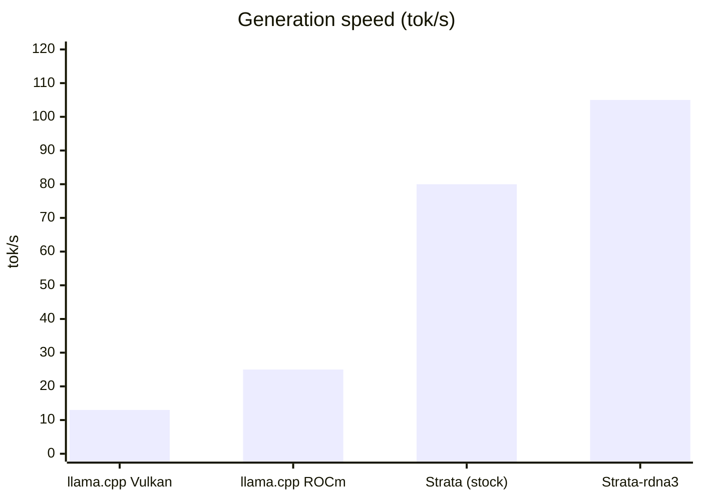
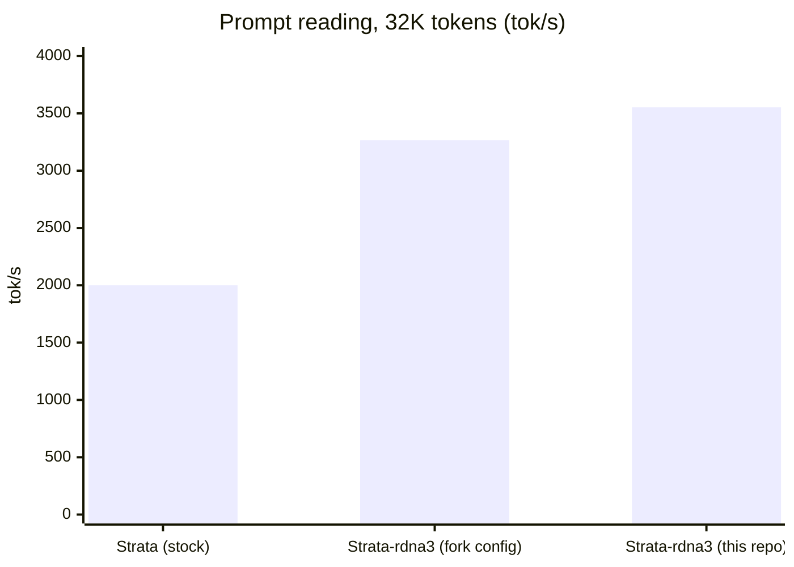

# rdna3-moe-tuning

Run **Qwen3.8-Flash-Next (IQ3_S, 82 GB MoE)** on a **single RX 7900 XTX (24 GB)** at **100+ tok/s**,
within a 294 W power cap. One script installs, tunes, serves and benchmarks
[Strata-rdna3](https://github.com/nicejunjie/Strata-rdna3), a gfx1100-tuned fork of the Strata engine.

The model is 3–4× larger than VRAM. The engine keeps the most-used experts in VRAM (~90% hit rate), computes
the rest on the CPU in parallel, and drafts 4 tokens ahead with an MTP head.

## Results

Single user, distinct prompts, 256 generated tokens, median of 5 (RX 7900 XTX, Ryzen 9 7945HX, 92 GB DDR5-5200, ROCm 7.2.4).





| | prompt 8K | prompt 32K | generation |
|---|---:|---:|---:|
| **this repo** | **2,840** | **3,553** | **102–108** |
| fork's shipped config | 2,641 | 3,266 | 103–104 |
| fork author (9950X3D2, DDR5-6000) | 2,436 | 3,541 | 114–119 |
| stock Strata 0.1.62 | ~1,900 | ~2,000 | 71–85 |
| llama.cpp ROCm `-ncmoe 32 -ub 2048 -fa 1` | 1,112 (2K) | — | 25 |
| llama.cpp Vulkan `-ncmoe 22` | 103 (512) | — | 13 |

Raw numbers: [`measurements.csv`](snapshot/2026-11-21/measurements.csv),
[`fork-sweeps.txt`](snapshot/2026-11-21/fork-sweeps.txt).

## Install

Needs Ubuntu 24.04 (or similar), ROCm 7.x in `/opt/rocm`, your user in the `render` and `video` groups,
~140 GB of free disk, and 64 GB+ RAM.

```bash
git clone https://github.com/toreanjoel/rdna3-moe-tuning && cd rdna3-moe-tuning
./strata-rdna3.sh install    # deps (sudo), engine build for gfx1100, model download if missing, expert pack
./strata-rdna3.sh serve      # tune the card, start the server in the background
```

The server speaks OpenAI (`/v1/chat/completions`) and Anthropic (`/v1/messages`) on `127.0.0.1:8080`:

```bash
curl -s localhost:8080/v1/chat/completions -H 'Content-Type: application/json' \
  -d '{"messages":[{"role":"user","content":"hi"}],"max_tokens":64}'
```

Coding tools work against it with tool calls and streaming: OpenAI chat (Cursor, Continue, Cline, Roo, Aider),
Anthropic messages (Claude Code: `ANTHROPIC_BASE_URL=http://127.0.0.1:8080`) and OpenAI Responses (Codex).
`python3 tools/api_smoke.py [url]` checks all three (9/9 pass on 2026-11-22).

## Commands

| command | does |
|---|---|
| `install` | one-time setup (idempotent) |
| `serve` | apply tuning, (re)start the server; survives logout |
| `stop` / `status` | stop it / port, process, GPU power and VRAM |
| `monitor` | attach a live view (speed, requests, GPU); `q` detaches, server keeps running |
| `speed` | follow each request's prompt and generation tok/s from the log |
| `quality` | ~1 h: FAST vs exact on this box: next-token agreement, KL, perplexity, HumanEval pass@1 |
| `bench [lengths]` | the fork's benchmark (default `8192,32768`) |
| `tune` | apply clocks and power only |
| `uninstall` | remove everything the script created |

Everything lives under one folder (`R=`, default `~/work/rdna3`): `engine/`, `data/` (model, expert pack,
MTP head), `logs/`, `bench/`.

## Settings

Defaults are the measured best within the card's limits. Override any of them per run, for example
`WATTS=250 ./strata-rdna3.sh serve`.

| variable | default | notes |
|---|---|---|
| `FAST` | 1 | skip low-ranked missed experts: decode ~110 tok/s, answers change slightly ([below](#what-was-tried)); `0` = exact |
| `CTX` | 131072 | max context; the fork ships 262144 (128K frees ~1% more expert slots) |
| `WATTS` | 294 | power cap; the ceiling for this card |
| `SCLK` | 2300 | core clock max (MHz); higher brings coil whine for ~1 tok/s |
| `MCLK` | 1300 | VRAM clock (MHz); generation waits on it |
| `VO` | -50 | core voltage offset (mV) |
| `EPP` / `BOOST` | performance / 1 | the CPU computes the experts not cached in VRAM |
| `TABLE` | hipBLASLt `100202` | matches ROCm 7.2.x: prompts +8% |
| `HOST` / `PORT` | 127.0.0.1 / 8080 | `HOST=0.0.0.0` for the LAN |
| `XENV` / `XARGS` | — | extra engine env / flags, e.g. `XARGS="--spec 3"` |
| `NAME` / `REPEATS` | default / 3 | bench run name and repeats |

## What was tried

| change | effect | kept |
|---|---|---|
| hipBLASLt table matching ROCm 7.2.x | prompts +7.5% (8K), +8.8% (32K) | yes |
| `--adapt-swaps 48` / `64` | within noise | no |
| `STRATA_AUX_CPUS=auto` | none | no |
| `--pool-workers 14` | none | no |
| `--pcie-frac 0.15` | generation −5% | no |
| `--spec-min-p 0.3`, `--lookup-chain 3` | within noise | no |
| `STRATA_MTP_DRAFT_ALL`, `MTP_QFUSE/MULTICOPY/GR_R8` | within noise | no |
| `STRATA_MEGAKERNEL=1` | within noise | no |
| `STRATA_IQ_PREFETCH` 1024 / 4096, `STRATA_CPU_YMM=1` (CPU expert kernels) | within noise | no |
| `STRATA_ROUTE_TAIL_SKIP=7` (`FAST=1`, default) | decode 101→111 (8K), 103→109 (32K); top-1 agreement 92.6%, KL 0.050, reference perplexity 4.064→4.041 | yes |
| `STRATA_ROUTE_TAIL_SKIP=8` | decode 109 / 106; KL 0.047 | no (tail7 faster, same cost) |
| `STRATA_ROUTE_RESIDENT=0.5` / `1.0`, `STRATA_ROUTE_PRIOR=0.5` | decode 105–110; KL 0.08–0.09, top-1 ~90% | no |
| llama.cpp (Vulkan, ROCm) | 4–8× slower generation | no |

Generation sits at ~100–108 tok/s at 8–32K context: each step waits on the ~10% of experts computed on the CPU,
which is bound by dual-channel DDR5. Left out on purpose: higher clocks or power, and 47 GB of reserved huge pages. The next big step is hardware: a second 7900 XTX (the author's
runs reach 130–170 tok/s).

## Repo

| path | what |
|---|---|
| `strata-rdna3.sh` | the script |
| `tools/` | benchmark sweeps behind "What was tried" |
| `snapshot/2026-11-21/` | measurements and an archive of the earlier stock-Strata setup |
| [`docs/history-stock-strata.md`](docs/history-stock-strata.md) | the stock-Strata investigation (clocks, power, decode ladder) |
